# A Tour of nbsandbox

A walk through what nbsandbox does, screen by screen: first the web editor, then the same things through the API, the way another service uses it. Every screenshot and every output below is real, taken from the development stack (`make up`) with the example notebooks in [examples/notebooks](../examples/notebooks). `make tour` retakes the screenshots.

The example is a small sales analysis: [sales_report.ipynb](../examples/notebooks/sales_report.ipynb) reads `data/sales.csv`, summarises one region's last few months, returns the totals as JSON and writes a CSV file; [sales_by_month.ipynb](../examples/notebooks/sales_by_month.ipynb) sends the same numbers month by month as it computes them.

## Part 1: the web editor

The web UI ships with nbsandboxd for local development (on http://127.0.0.1:8090 with `make up`). It acts as whichever user you pick, without a password, so it never runs in production; everything it does goes through the same API as any client.

### 1. Spaces

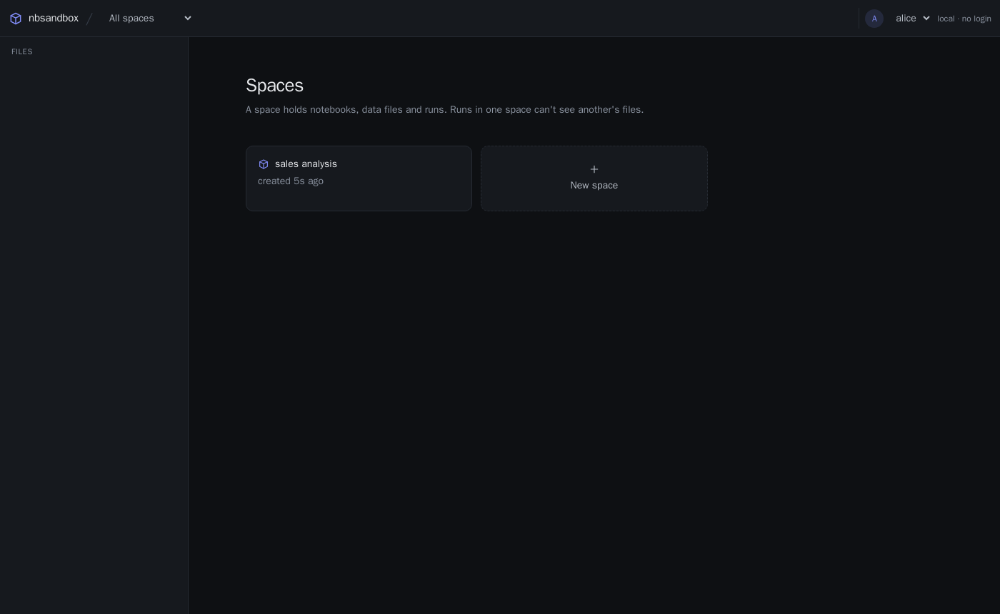

A **space** holds notebooks, data files and runs. It belongs to one user (here `alice`, picked at the top right); another user can't see it, list it or guess its contents.

### 2. A space

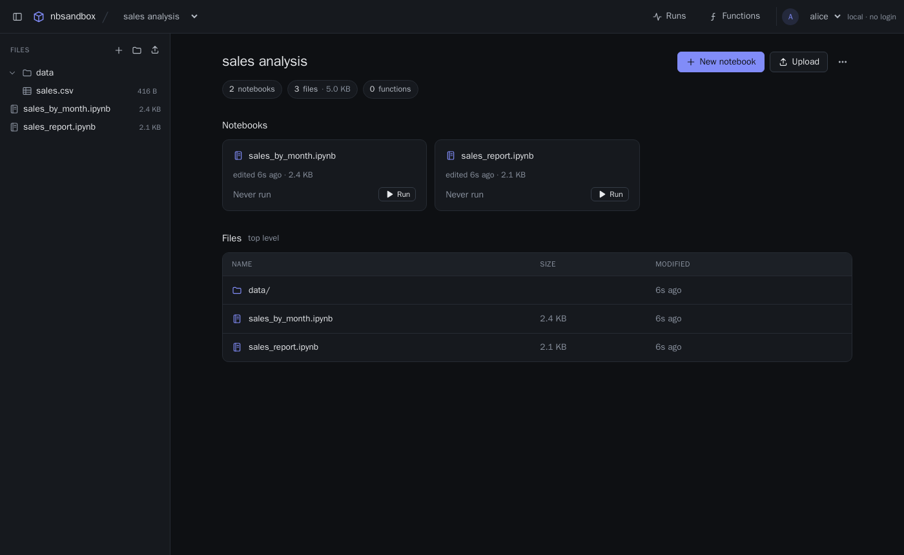

The space overview: its notebooks with their last run, and its files. The tree on the left is the same. Files are uploaded here, or through the API; their contents are stored in object storage, once each, however many files share them.

### 3. The notebook editor

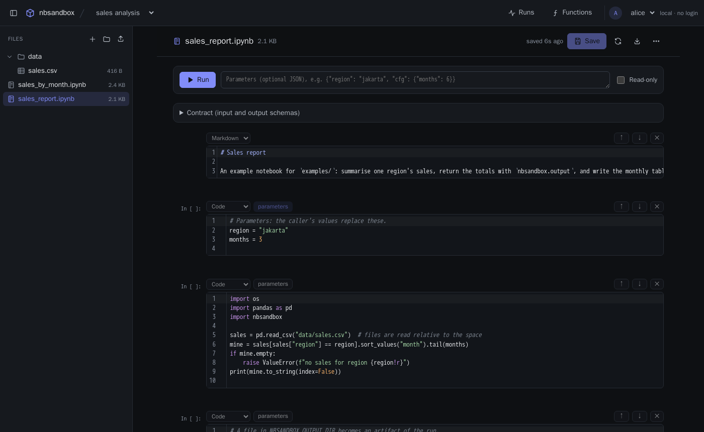

Notebooks are edited cell by cell, with syntax highlighting. The **Run** bar at the top takes the run's parameters as JSON: they replace the values in the cell tagged `parameters`. The collapsed **Contract** panel holds the notebook's input and output schemas, which are checked before a run starts and after it ends.

### 4. Completion from the runner image

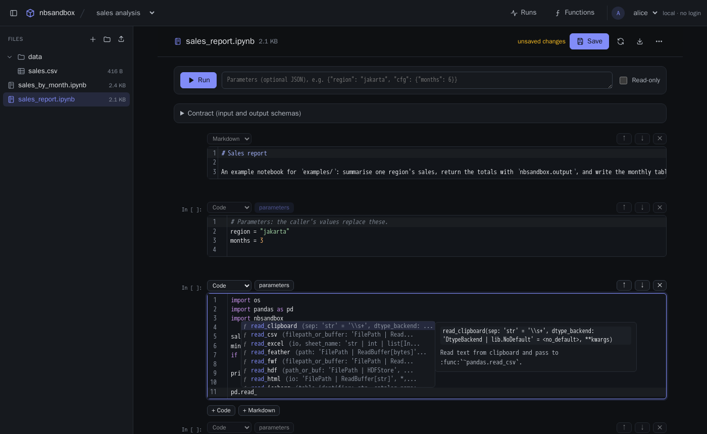

Completion knows the packages installed in the runner image, the exact versions notebooks run with: typing `pd.read_` lists pandas' readers, each with its signature and the first line of its documentation. The index is built into the image when it is built, so it always matches.

### 5. Documentation on hover

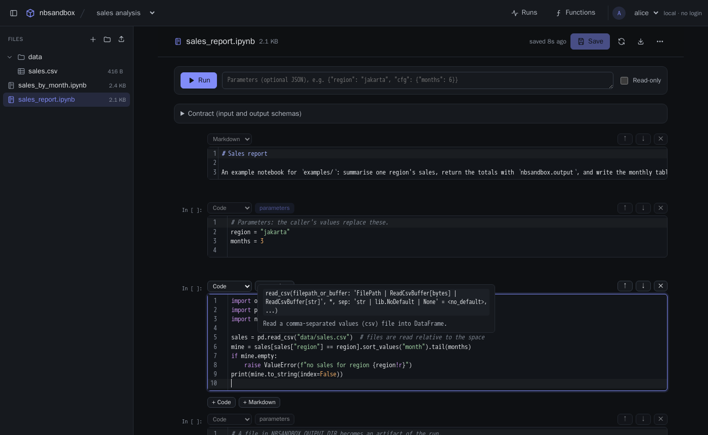

Hovering a name shows its signature and summary.

### 6. A run, followed live

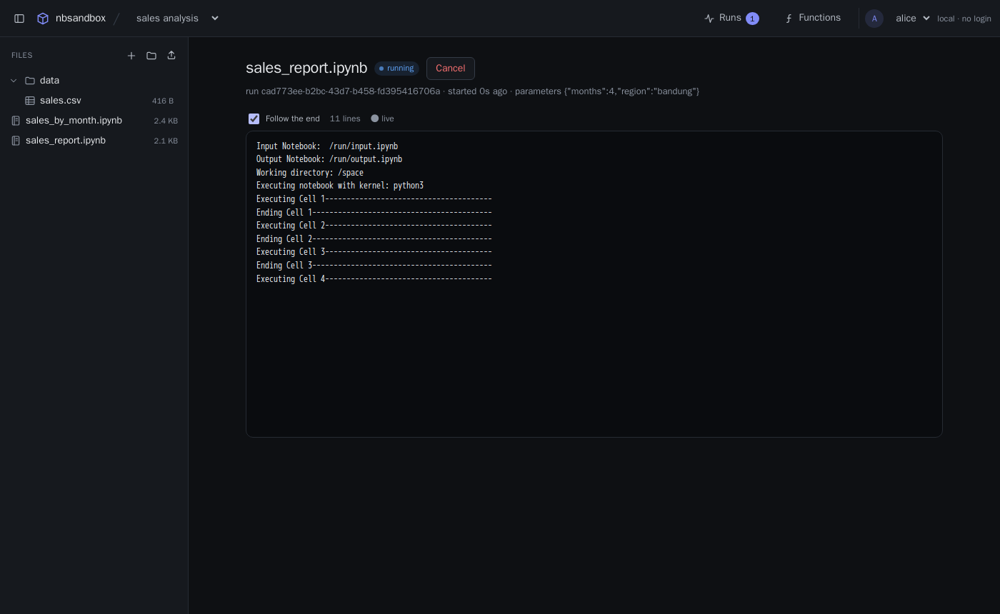

Pressing **Run** (here with `{"region": "bandung", "months": 4}`) starts a **run**: a fresh container with no network, its own copy of the space's files, and fixed limits on memory, CPU, processes and time. The log arrives line by line as the notebook writes it.

### 7. The result

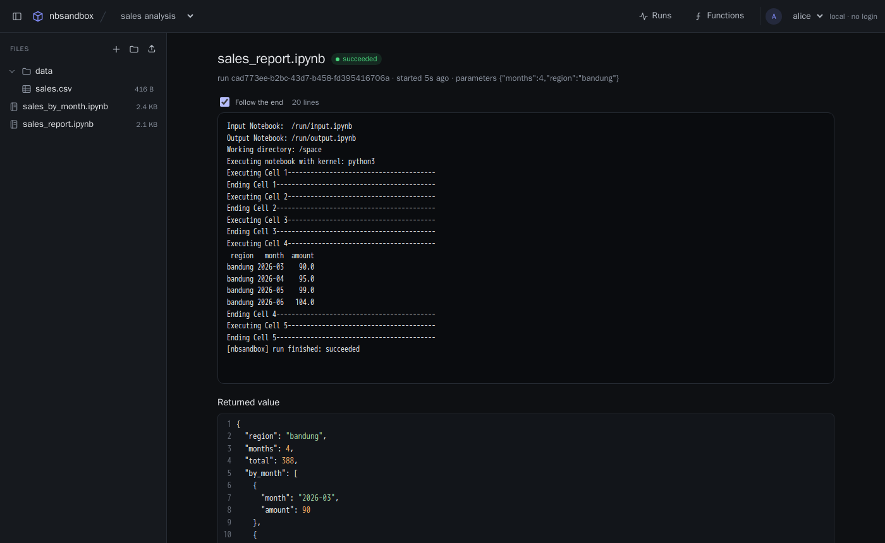

When it ends: the status, the value the notebook returned with `nbsandbox.output(...)`, how long it took and how much memory and CPU it used, the executed notebook, a rendered HTML copy, the log, and the **artifacts**, the files it wrote to its output folder (here `monthly.csv`). A failure says which cell failed and why, and whether it was the notebook's fault or the platform's.

### 8. The rendered notebook

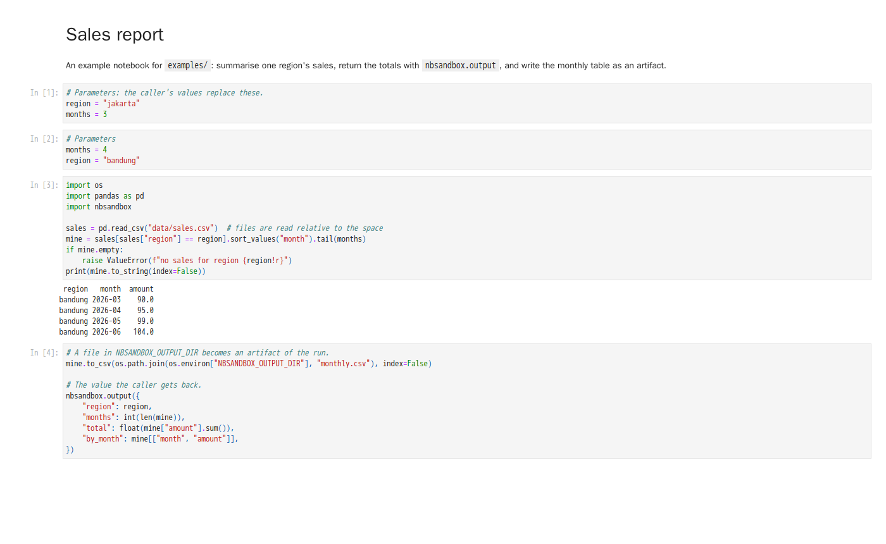

The executed notebook as HTML: the run's parameters appear in their own cell after the defaults. It is served in a sandbox where no script can run, whatever the notebook printed.

### 9. Publishing as a function

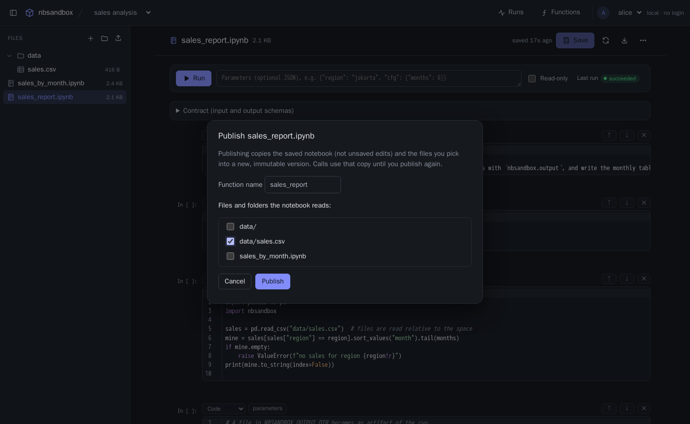

A notebook becomes a **function** that other services call with JSON. Publishing copies the saved notebook and the files you pick into an immutable **version**: editing the notebook or its data afterwards changes nothing for callers until you publish again.

### 10. The function

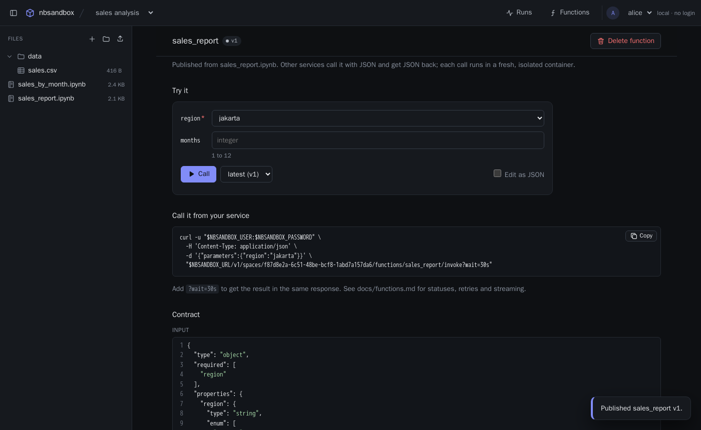

The function's page builds a form from the input contract (`region` is one of three values; `months` is 1 to 12), and shows the `curl` command a service would use.

### 11. Calling it

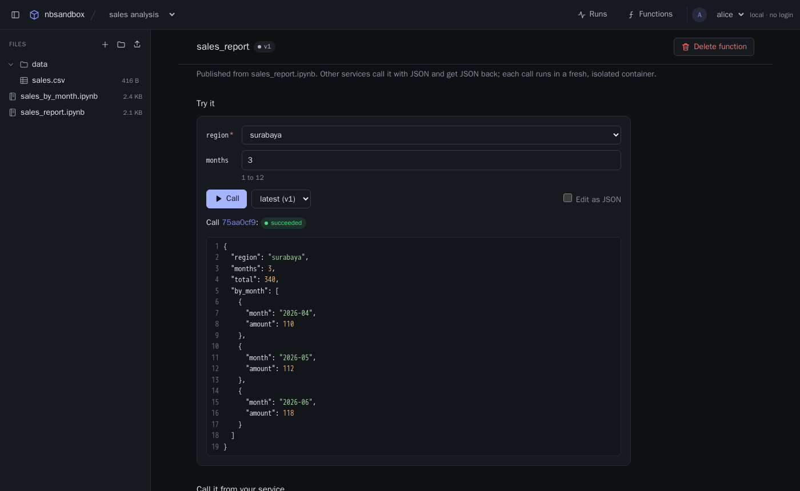

Each call runs in its own fresh container, read-only, from the published version. Calls to the same function run side by side.

### 12. Runs and calls

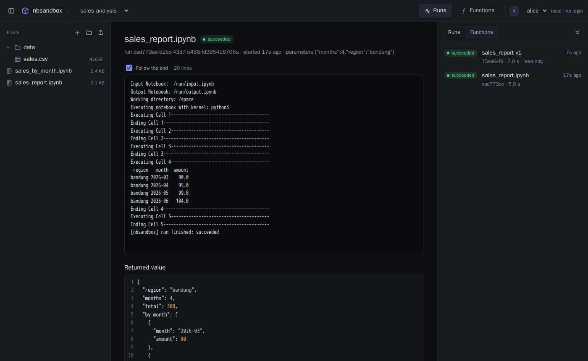

The **Runs** panel lists the space's runs and function calls, newest first, live.

## Part 2: the API

The same things from a service, with `curl`. The API is REST with an [OpenAPI spec](../api/openapi.yaml), and also gRPC ([api.md](api.md)). In development it takes basic auth; in production, bearer tokens from your identity provider ([auth.md](auth.md)).

```bash
export U=http://127.0.0.1:8080 A=alice:alice-dev-password
```

### What runs notebooks

```bash
curl -s -u $A $U/v1/runtime
```

```json
{
  "runtime": "runc",
  "image": {
    "ref": "nbsandbox-runner:dev",
    "id": "sha256:3c7a6e817519841da72fa990f8d9c5cef6abba06adc635e41e89a8b67196a5d2"
  },
  "python_version": "3.13.18",
  "limits": {
    "memory_bytes": 2147483648,
    "cpus": 1,
    "pids": 256,
    "tmp_bytes": 268435456,
    "timeout_seconds": 600,
    "log_bytes": 10485760,
    "max_file_bytes": 52428800,
    "max_space_bytes": 524288000,
    "concurrency": 2
  },
  "packages": { "asttokens": "3.0.2", "attrs": "26.1.0", "beautifulsoup4": "4.15.0", "…": "…" }
}
```

The image, its Python, its packages and the limits every run gets. Requests can't change the limits.

### Start a run

```bash
curl -s -u $A -H 'Content-Type: application/json' -H 'Idempotency-Key: tour-1' \
  -d '{"notebook":"sales_report.ipynb","parameters":{"region":"jakarta","months":3}}' \
  $U/v1/spaces/$S/runs
```

```json
{"id":"e768c889-c007-4fb9-9fcc-fe97f08ade16","space_id":"f87d8e2a-6c51-48be-bcf8-1abd7a157da6","notebook":"sales_report.ipynb","notebook_sha256":"7f4525dd0ddc1bb22b766ab97aa48c8db0d0c371a654fc3de10338570c8b3f83","read_only_space":false,"parameters":{"months":3,"region":"jakarta"},"status":"queued","retryable":false,"queue_position":1,"created_at":"2026-11-08T05:46:46.494Z"}
```

The `Idempotency-Key` makes a retry safe: the same key returns the same run instead of starting a second one.

### Follow its log

```bash
curl -s -N -u $A $U/v1/spaces/$S/runs/$RUN/log/stream
```

```text
: nbsandbox log stream

id: 1
event: line
data: Input Notebook:  /run/input.ipynb

id: 2
event: line
data: Output Notebook: /run/output.ipynb

id: 3
event: line
data: Working directory: /space
…
```

Server-Sent Events: each line has an id, so a client that reconnects with `Last-Event-ID` continues without gaps or duplicates.

### Get the result

```bash
curl -s -u $A "$U/v1/spaces/$S/runs/$RUN/result?wait=30s"
```

```json
{
  "run_id": "e768c889-c007-4fb9-9fcc-fe97f08ade16",
  "status": "succeeded",
  "output": {
    "region": "jakarta",
    "months": 3,
    "total": 489.0,
    "by_month": [
      { "month": "2026-04", "amount": 160.0 },
      { "month": "2026-05", "amount": 158.0 },
      { "month": "2026-06", "amount": 171.0 }
    ]
  }
}
```

`?wait=30s` answers as soon as the run finishes, so a client doesn't need to poll. The artifact:

```bash
curl -s -u $A $U/v1/spaces/$S/runs/$RUN/artifacts/monthly.csv
```

```text
region,month,amount
jakarta,2026-04,160.0
jakarta,2026-05,158.0
jakarta,2026-06,171.0
```

What the run used, from `GET …/runs/$RUN`:

```json
{
  "status": "succeeded",
  "usage": { "duration_seconds": 4.74, "peak_memory_bytes": 123797504, "cpu_seconds": 4.31 },
  "runtime": "runc",
  "limits": { "memory_bytes": 2147483648, "cpus": 1, "pids": 256, "timeout_seconds": 600 }
}
```

### Call a function

```bash
curl -s -u $A -H 'Content-Type: application/json' \
  -d '{"parameters":{"region":"jakarta","months":2}}' \
  "$U/v1/spaces/$S/functions/sales_report/invoke?wait=30s"
```

```json
{
  "run_id": "6e236877-9406-4f04-9633-a2a02f2e03ff",
  "status": "succeeded",
  "function": "sales_report",
  "version": 1,
  "output": {
    "region": "jakarta",
    "months": 2,
    "total": 329.0,
    "by_month": [
      { "month": "2026-05", "amount": 158.0 },
      { "month": "2026-06", "amount": 171.0 }
    ]
  }
}
```

Parameters that break the contract are refused before anything runs:

```bash
curl -s -u $A -H 'Content-Type: application/json' \
  -d '{"parameters":{"region":"medan"}}' \
  "$U/v1/spaces/$S/functions/sales_report/invoke?wait=30s"
```

```json
HTTP 400
{"error":{"code":"invalid_parameters","message":"parameters don't match the notebook's input contract: /region: value must be one of 'jakarta', 'bandung', 'surabaya'","problems":[{"pointer":"/region","message":"value must be one of 'jakarta', 'bandung', 'surabaya'"}]}}
```

### A function that streams its output

`sales_by_month` declares a streamed output and sends one item per month with `nbsandbox.emit(...)`. Asking for `text/event-stream` gets the items as they are made (the times on the left were added by the client):

```bash
curl -s -N -u $A -H 'Content-Type: application/json' -H 'Accept: text/event-stream' \
  -d '{"parameters":{"region":"bandung","months":4}}' \
  $U/v1/spaces/$S/functions/sales_by_month/invoke
```

```text
  0.0s  : nbsandbox result stream
  3.2s  event: item
  3.2s  data: {"index":1,"total":4,"item":{"month":"2026-03","amount":90.0,"running_total":90.0}, …}
  3.7s  event: item
  3.7s  data: {"index":2,"total":4,"item":{"month":"2026-04","amount":95.0,"running_total":185.0}, …}
  4.2s  event: item
  4.2s  data: {"index":3,"total":4,"item":{"month":"2026-05","amount":99.0,"running_total":284.0}, …}
  4.7s  event: item
  4.7s  data: {"index":4,"total":4,"item":{"month":"2026-06","amount":104.0,"running_total":388.0}, …}
  6.8s  event: result
  6.8s  data: {"status":"succeeded","output":[…the four items…],"items":4, …}
```

The first item arrives about 3 seconds after the call (the container starts and the kernel loads pandas), then one every half second, as the notebook produces them.

### Another user sees nothing

```bash
curl -s -u bob:bob-dev-password $U/v1/spaces/$S/runs/$RUN/log
```

```json
HTTP 404
{"error":{"code":"not_found","message":"not found"}}
```

Another user's space doesn't exist as far as bob is concerned: `404`, never `403`, so its existence isn't revealed either.

## Next

- **Try it yourself:** the [README's quickstart](../README.md#quickstart-local-docker-desktop-or-linux), then [examples/](../examples/) for complete clients in Python and Go.
- **How isolation is checked:** the [isolation reports](isolation-report.md) list every check and what it observed.
- **Deploying:** [deployment.md](deployment.md) (one server), [kubernetes.md](kubernetes.md), [gvisor.md](gvisor.md).
